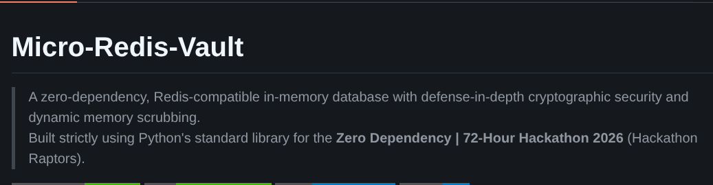

<h1 align="center">
  Hi There! I'm Chandramouli Baskaran 
  
</h1>

  

  
  
  

---

## 👨‍💻 About Me

- 🎓 **Student**: Pre-final year student diving deep into **Cybersecurity**, **Backend Engineering**, and **DevOps**.
- 🔐 **Research & Interests**: Actively exploring **Post-Quantum Cryptography** and **Hardware Security**.
- ⚙️ **Systems & Cloud**: Love architecting resilient microservices, custom VPC networks, and CI/CD automation.
- ✍️ **Technical Writing**: Sharing insights and tutorials on [Medium](https://medium.com/@chandra_1810) and [Substack](https://substack.com/@chandramoulibaskaran).
- 💬 **Ask Me About**: In-memory stores, Linux internals, network packet analysis, and security hardening.

---

## 🧰 Tech Stack & Tools

### Languages, Cloud & DevOps

  
  

### 🛡️ Cybersecurity & Pentesting Toolbox

  
  
  
  

> **Core proficiencies**: Relational Databases (PostgreSQL), Cloud Networking (VPC, IAM, Security Groups), CI/CD Automation (GitHub Actions), Packet Inspection & Network Auditing.

---

## 🚀 Featured Projects

<table>
  <tr>
    <td align="center" width="33%">
      
       
      <b>Micro-Redis Vault</b> 
      Lightweight, Redis-compatible in-memory store engineered for high-throughput caching and security.  
      
       
      <code>C/Python</code> • <code>In-Memory DB</code> • <code>Systems</code>
    </td>
    <td align="center" width="33%">
      
       
      <b>Automated Cloud CI/CD Pipeline</b> 
      Zero-downtime automated deployment workflow leveraging GitHub Actions, Docker, and AWS.  
      
       
      <code>DevOps</code> • <code>Docker</code> • <code>AWS</code> • <code>CI/CD</code>
    </td>
    <td align="center" width="33%">
      
       
      <b>Hardened AWS VPC Architecture</b> 
      Custom isolated VPC with multi-tier public/private subnets, NAT gateways, and strict NACL rules.  
      
       
      <code>AWS</code> • <code>Networking</code> • <code>Cybersecurity</code>
    </td>
  </tr>
</table>

---

## 📊 GitHub Analytics

  
  

  

---

## ✍️ Publications & Blogs

  
  &nbsp;
  

---

## 🤝 Connect With Me

  
  
  
  
  

---

## 💼 Looking for Opportunities?

  

