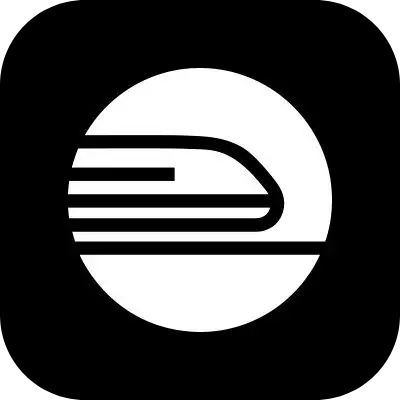
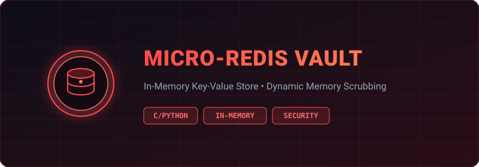
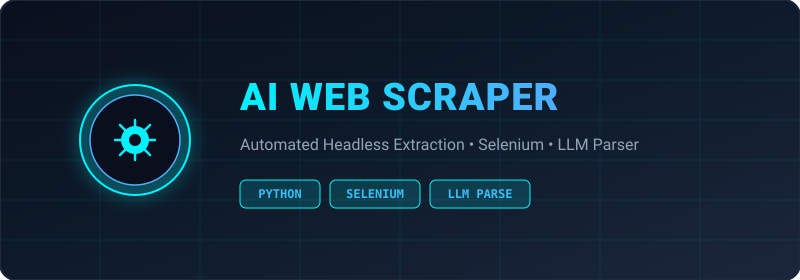
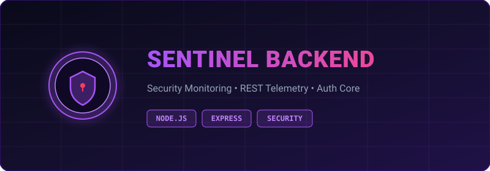

<h1 align="center">
  Hi There! I'm Chandramouli Baskaran 
  
</h1>

  

  
  
  

---

## 👨‍💻 About Me

- 🎓 Pre-final year student at **VIT Chennai** diving deep into **Cybersecurity**, **Backend Engineering**, and **Systems Architecture**.
- ⚙️ Love architecting resilient in-memory stores, custom VPC networks, and low-level tools from scratch.
- 💬 **Ask Me About**: In-memory stores, Linux internals, network packet analysis, and security hardening.

---

## 🧠 Brain-Scratching On...

- 🔐 **Post-Quantum Cryptography**: Exploring lattice-based cryptographic algorithms and Keccak/SHA-3 implementations.
- ⚡ **Low-Latency Systems**: Investigating memory layout, socket multiplexing, and concurrency bottlenecks in cache engines.
- 🛡️ **Hardware Security**: Understanding physical side-channel leaks, fault injection, and hardware root-of-trust models.

---

## 🧰 Tech Stack & Tools

### Languages, Cloud & DevOps

  
  

### 🛡️ Cybersecurity & Pentesting Toolbox

  
  
  
  

> **Core proficiencies**: Relational Databases (PostgreSQL), Cloud Networking (VPC, IAM, Security Groups), CI/CD Automation (GitHub Actions), Packet Inspection & Network Auditing.

---

## 🚀 Featured Projects

<table>
  <tr>
    <td align="center" width="33%">
      
       
      <b>Micro-Redis Vault</b> 
      Lightweight, Redis-compatible in-memory store engineered for high throughput and security benchmarking.  
      
       
      <code>C/Python</code> • <code>In-Memory DB</code> • <code>Systems</code>
    </td>
    <td align="center" width="33%">
      
       
      <b>AI Web Scraper</b> 
      Automated extraction pipeline pairing headless Selenium browsing with LLM-assisted context parsing.  
      
       
      <code>Python</code> • <code>Selenium</code> • <code>LLM Parsing</code>
    </td>
    <td align="center" width="33%">
      
       
      <b>Sentinel Backend</b> 
      Robust backend service architected with Express and Node.js for security telemetry and state routing.  
      
       
      <code>Node.js</code> • <code>Express</code> • <code>Security API</code>
    </td>
  </tr>
</table>

---

## 📜 Certifications

  
  &nbsp;
  

---

## 📊 GitHub Analytics

  
  

  

---

## ✍️ Technical Writing & Blogs

  
  

<!-- BLOG-POST-LIST:START -->
- [When RAM Betrays Your Secrets: Building an Encrypted, Zero-Dependency Redis from Scratch](https://medium.com/@chandra_1810/when-ram-betrays-your-secrets-building-an-encrypted-zero-dependency-redis-from-scratch-e53e7f29c8c9?source=rss-98b825d4dc35------2) — *Thu Sep 10 2026 3:51 PM*
- [When CPUs Betray Us: Understanding Spectre](https://medium.com/@chandra_1810/when-cpus-betray-us-understanding-spectre-429e0485fbfc?source=rss-98b825d4dc35------2) — *Thu Jul 09 2026 5:27 PM*
- [Your VMs are not as safe as you think](https://medium.com/@chandra_1810/your-vms-are-not-as-safe-as-you-think-ccf6cfbc78e0?source=rss-98b825d4dc35------2) — *Sat May 16 2026 6:16 PM*
- [Goodbye Windows, Hello Fedora: My One-Month Experience](https://medium.com/@chandra_1810/goodbye-windows-hello-fedora-my-one-month-experience-3fea811e4260?source=rss-98b825d4dc35------2) — *Thu Dec 04 2025 5:04 AM*<!-- BLOG-POST-LIST:END -->

---

## 🤝 Connect With Me

  
  
  

---

## 📄 Resume

  

